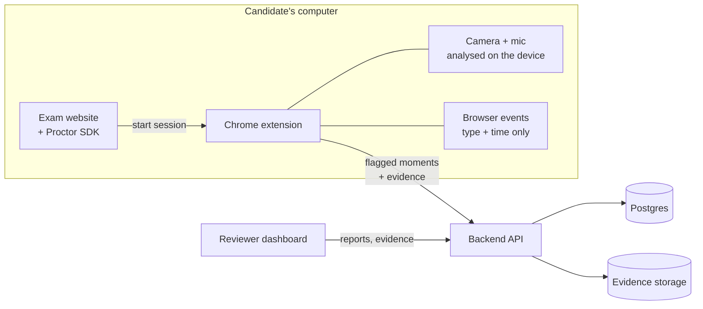

# Hawkeye

_See what matters._

Hawkeye is the product name. Internal identifiers keep the original `proctor` naming
(`@proctor/*` packages, `PROCTOR_*` variables, the `ai-proctor` Docker Compose project) so
existing builds, environments and databases keep working.

Advisory proctoring for online exams. A Chrome extension watches for signs of possible
misconduct during an exam, a backend turns what it finds into an explainable **risk score**,
and a dashboard lets **human reviewers** look at the evidence and decide.

> **The system never passes, fails, blocks or disqualifies anyone.** It only flags moments for a
> person to review.

## How it works



1. **The exam website starts a session.** The exam provider's server asks the backend for a
   session, and the exam page passes the session token to the extension through the small
   [SDK](packages/sdk).
2. **The candidate agrees first.** The extension shows a consent notice that explains what is
   monitored. If the candidate declines, nothing starts. A setup check then tests the camera,
   microphone and device speed. It gives advice but never blocks the exam.
3. **Monitoring happens on the candidate's device.**
   - **Webcam:** a few frames at random moments (5 every 30 s by default) are checked by on-device
     models for no face, more than one person, a phone, books or notes, and looking away for a
     long time.
   - **Microphone:** a voice detector listens on the device. Audio is saved only when someone
     speaks, as a short clip.
   - **Browser:** leaving fullscreen, switching tabs, copy/paste, refreshing and inactivity.
     Only the event type and time are recorded, never URLs, page content or keystrokes.
4. **Only flagged moments leave the device.** Each flagged moment is uploaded with its evidence:
   the frames, the audio clip and the browser events around it. Uploads are queued and retried, so
   they survive a lost connection or a browser restart.
5. **The backend scores the session.** Repeated flags are merged into **violations**, and each
   one is given points by severity and confidence. The browser, video and audio scores are then
   combined with weights into a **risk score from 0 to 100 (Low / Medium / High)**. The score can
   always be recomputed from the violations and the policy that was in force.
6. **A reviewer decides.** The dashboard ranks sessions by risk. For each session it shows how the
   score was calculated, a timeline, and the evidence for every flagged moment.

Every threshold, weight and sampling rate comes from an editable **policy**, set for the whole
organisation or for one exam. Each session keeps a snapshot of the policy it was scored under.

More detail: [docs/ARCHITECTURE.md](docs/ARCHITECTURE.md).

### Privacy rules

- No screen recording, and no full video or audio recording.
- Media leaves the device only as sampled frames around a flagged moment, or short speech clips.
- Browser events are stored as type + timestamp only.
- No identification of people. An optional "same face as at the start" check exists. It is off
  by default, needs a separate opt-in from the candidate, and keeps its data in memory on the
  device only.
- Every flagged moment links to its evidence, and every view of evidence is audit-logged.
- Data is deleted automatically after the retention period.

See [docs/PRIVACY_REVIEW.md](docs/PRIVACY_REVIEW.md) and [docs/privacy-policy.md](docs/privacy-policy.md).

## Quick start: try the whole thing

You need **Node 24+**, **pnpm 10**, **Docker Desktop** (running) and **Google Chrome**.

```sh
pnpm install
pnpm demo
```

`pnpm demo` starts the databases in Docker, sets up demo data, builds the extension, and runs:

| What                     | Where                 |
| ------------------------ | --------------------- |
| Demo exam website        | http://localhost:4500 |
| Reviewer dashboard       | http://localhost:5173 |
| Backend API              | http://localhost:4000 |
| MinIO console (evidence) | http://localhost:9001 |

Then:

1. **Install the extension (once).** In Chrome, open `chrome://extensions`, turn on
   **Developer mode**, click **Load unpacked** and choose `apps/extension/build`.
2. **Take an exam.** Open http://localhost:4500, click **Start exam**, accept the notice, allow
   the camera and microphone, then try things like leaving fullscreen, switching tabs, holding up
   a phone or talking. Click **Finish exam**.
3. **Review it.** Open http://localhost:5173 and sign in as `reviewer@proctor.test` or
   `admin@proctor.test` with the password `change-me-please`. Your session appears in the list
   within a few seconds.

Press **Ctrl+C** to stop the servers. To stop the databases, run
`docker compose -f infra/docker-compose.yml down`. If you change the extension, run
`pnpm demo --rebuild-extension` and click the reload icon on the extension's card in Chrome.

> These logins and passwords are for local development only.

## Developer setup

```sh
pnpm install
pnpm test        # unit + integration tests (Docker must be running)
pnpm lint        # ESLint + Prettier
pnpm typecheck   # TypeScript
```

Running parts on their own, end-to-end tests, build options and the release checklist are
described in [docs/DEVELOPMENT.md](docs/DEVELOPMENT.md).

## Project layout

```
packages/core       pure logic: policy, scoring, sampling, merging, rules, schemas
packages/sdk        script the exam website uses to start a session
packages/ui         shared React components
apps/extension      Chrome extension (Manifest V3)
apps/api            backend: Fastify + Postgres + S3-compatible storage
apps/dashboard      reviewer and admin dashboard (React)
apps/demo-host      demo exam website, an example integration
infra/              docker-compose for Postgres and MinIO
e2e/                Playwright end-to-end tests
scripts/            pnpm demo
docs/               architecture, development, privacy, fairness, performance, store listing
```

## Tech stack

TypeScript everywhere, pnpm workspaces, Vitest, Playwright, zod.
**Extension:** Vite + CRXJS, MediaPipe Tasks Vision and Silero VAD (onnxruntime-web), all
models bundled.
**Backend:** Fastify, Postgres (Drizzle), MinIO / S3.
**Dashboard:** React, Vite, TanStack Query, Tailwind.

## Documentation

| Document                                    | What's in it                                            |
| ------------------------------------------- | ------------------------------------------------------- |
| [ARCHITECTURE.md](docs/ARCHITECTURE.md)     | how each part works, scoring, API, design decisions     |
| [DEVELOPMENT.md](docs/DEVELOPMENT.md)       | running parts separately, tests, debugging, releasing   |
| [PRIVACY_REVIEW.md](docs/PRIVACY_REVIEW.md) | each privacy requirement and the test that proves it    |
| [FAIRNESS.md](docs/FAIRNESS.md)             | how detection holds up across lighting, cameras, people |
| [PERFORMANCE.md](docs/PERFORMANCE.md)       | CPU, memory and upload budgets                          |
| [STORE_LISTING.md](docs/STORE_LISTING.md)   | Chrome Web Store text and permission reasons            |
| [privacy-policy.md](docs/privacy-policy.md) | privacy policy template                                 |
| [BUILD_PLAN.md](BUILD_PLAN.md)              | build phases, contracts and open questions              |

## Status

Pre-release: being prepared for a pilot. Progress and open questions are tracked in
[BUILD_PLAN.md](BUILD_PLAN.md).
